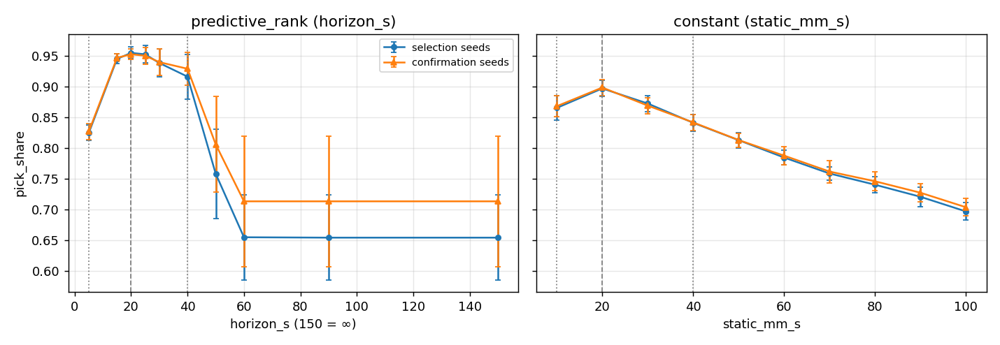
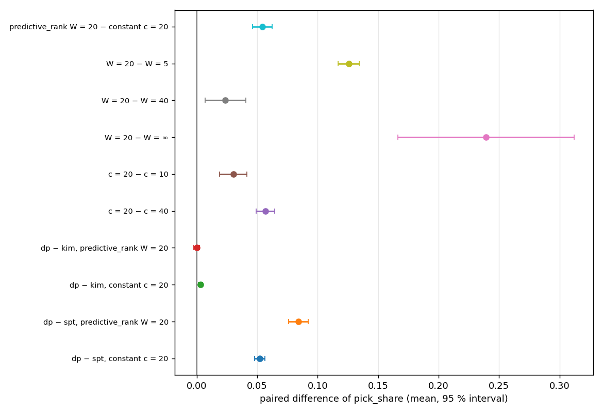
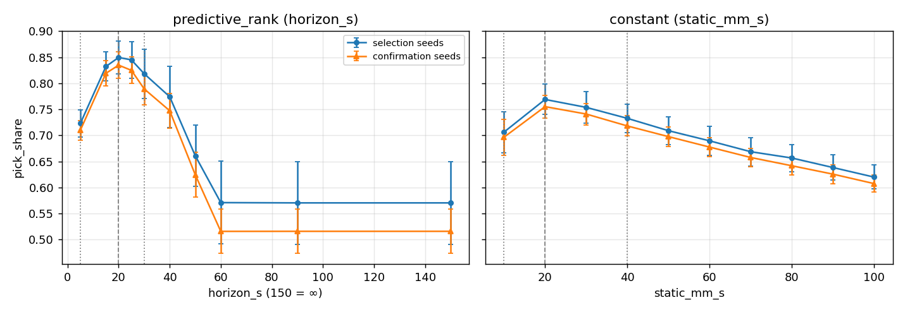
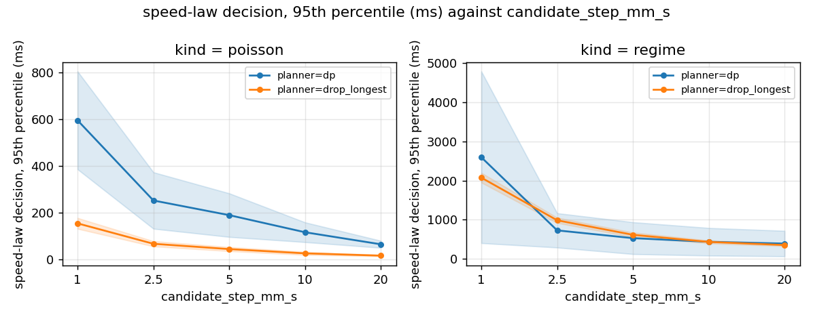

# Experiment notes — simulation and cell

Working list of the experiments of the study, what each one is for, what it needs and when it
is done. The contribution under test is the speed law `predictive_rank`; planners are a
secondary factor. Method of the identification the sandbox rests on:
[`plant-identification.md`](plant-identification.md). Open problems stay in
[`open-issues.md`](open-issues.md).

## 1. Design

* **Primary question (H1).** Does `predictive_rank` at a well-chosen horizon W pick more parts
  than the best constant belt speed, and than W = ∞ (the paper's setting)?
* **Secondary question (H2).** Does the planner matter? `dp` is the main planner (exact search
  over the `max_jobs` most urgent parts); KIM and SPT are compared with it at the chosen
  settings only. "dp is optimal" holds for the sequencing sub-problem of one decision, not
  for the closed loop (non-preemptible commit, stacks, the belt moving), so H2 is measured.
* **Risk to H1.** At a stationary load one well-tuned constant speed may do as well as
  `predictive_rank`; a closed-loop law should win when the load changes. The `regime` feeder
  (rate shifting between nominal, surge and starve) is therefore part of the plan.
* **Metric.** `pick_share` = picked / arrived (1000 parts per run). Others reported: picks per
  minute, covered-miss share, lost share, mean belt speed, seconds in throughput dips.
* **Paired design.** Every setting of a block sees the same seeds, so the same arrivals;
  differences are paired by seed.
* **Select, then confirm.** The best level of 10 is chosen on some seeds and measured on
  others. Measuring the choice on the data that made it reports its luck together with its
  merit (`sandbox/confirm.py`).

### Seeds

| Group | Seeds | Used for |
|---|---|---|
| Cell experiments | 1001–1010 | the cell only, as `feeder.seed`. Seed 1001's four runs of 2026-10-10 were also used to identify the plant, so a clean cell comparison should start from 1002 or accept that 1001 is not independent. |
| Selection | 2001–2020 | choosing W and the constant speed in the sandbox |
| Confirmation | 3001–3010 | measuring the chosen levels and the standard deviation of paired differences |
| Earlier | 110–114, 1001 | the W map, the plant identification and its replays (done) |

### Fixed in every run

`planner: dp` (`max_jobs` 16) unless a block varies it, `stack_aware: true`, stacking on
(a part landing on another covers it), Poisson feeder at 24 parts/min (`regime` where stated),
1000 parts (`feeder.max_parts`), `predictive_rank` inner planner `drop_longest`, candidate step
5 mm/s, band 5–100 mm/s, the plant identified from the cell (`sim.goto_extra_s`,
`sim.pick_extra_s`). Stack-blind runs are not part of the plan.

## 2. Simulation experiments

Run all with `bash sandbox/run_experiments.sh p1` (about 1–2 h on 15 cores); each can be run
alone by name. Results: `sandbox/results/<name>-<time>/`.

| ID | Spec | What | Runs | Output |
|---|---|---|---|---|
| S0 | `phase0_replay*.yaml`, `phase0_noise.yaml`, `w_map.yaml` | Plant identification, replay against the cell, noise floor, first W map (done) | – | `plant-identification.md` |
| S1 | `p1_select.yaml` | dp; W = 5, 15, 20, 25, 30, 40, 50, 60, 90, ∞ and constant 10–100 mm/s (step 10); selection seeds 2001–2020 | 20 cases × 20 seeds = 400 | the W and speed curves; the chosen levels |
| S2 | `p1_confirm.yaml` | the same 20 settings for dp, KIM and SPT on confirmation seeds 3001–3010 | 60 × 10 = 600 | paired differences, their `sd_d`, seeds needed on the cell |
| S3 | `p1_regime.yaml` | the same 20 settings for dp under the `regime` feeder; seeds 2001–2010 select, 3001–3010 confirm | 20 × 20 = 400 | H1 under a varying load |
| S4 | `solve_time.yaml` | decision time of dp and `predictive_rank` against dp `max_jobs` (8–24) and the candidate step (1–20 mm/s), inner planner `drop_longest` or `dp`, a cell-like and a stress load | 100 × 3 = 300 | milliseconds per decision, queue length, `pick_share` |

Analysis of S1/S2 and of S3 (run by the `p1` alias):

```bash
python3 -m sandbox confirm --select p1_select --confirm p1_confirm
python3 -m sandbox confirm --select p1_regime --select-seeds 2001-2010 \
    --confirm p1_regime --confirm-seeds 3001-3010
```

`confirmation.md` gives: the best level of each law on the selection seeds and the nearest level
at least 0.03 of `pick_share` worse on each side (the "low" and "high" levels of the cell);
every level on both seed sets; the paired differences below with `sd_d`, a 95 % interval, the
number of cell seeds that would detect each, and the smallest difference 3, 5 and 10 cell
seeds can detect (`sd_d` × 1.5 for the cell's jitter).

* `predictive_rank` W\* − constant c\*
* W\* − W(low), W\* − W(high), W\* − W(∞); c\* − c(low), c\* − c(high)
* dp − KIM and dp − SPT at W\* and at c\*

### Decision rules (fixed before the results)

1. **The claim stands on a varying load only if** the paired difference W\* − c\* of S3 is
   positive with an interval above 0. If it is not, the constant speed is as good under the
   `regime` feeder and the paper's claim needs rethinking before cell time is spent.
2. **Levels for the cell** are the three of S1 (low, W\*, high) plus W = ∞; the same for the
   constant speed. Adjusted after S2: the "high" W is 50, not 40 (see S2).
3. **A contrast is carried to the cell only if** the seeds it needs are at most 10; a smaller
   one is reported as "not distinguishable in the sandbox".
4. **W ≥ 45 s and loads above 28 parts/min** are used for the shape of a curve, not for
   absolute values (open-issues S3).

### S4 reading

The robot has a speed decision every second (`speed.control_period_s`) and plans while the arm
is free at the 50 ms poll (`runtime.poll_interval_s`). The sandbox's wall clock is this
machine's; the cell PC's is not measured. A setting is acceptable when the 95th percentile of a
decision is well below its period and the maximum does not approach it.

## 3. Cell experiments

Planned after S1–S3. One run of 1000 parts takes about 43 min (`feeder.max_parts` 1000, the
belt and the virtual feeder `simulate_feeder`); a run is skipped for the analysis if fewer
than 100 parts were picked (an aborted start).

| ID | What | Settings | Seeds | Why |
|---|---|---|---|---|
| C1 | Speed law, dp | `predictive_rank` at W = 5, 20, 50 and W = ∞ (≥ 60); `constant` at 10, 20, 30 mm/s | 1002–1006 (5 seeds) | H1 on the cell: the curve of each law and the gap between the best of each (S2: every contrast needs 3–5 seeds) |
| C2 | Planners | SPT at W = 20 (3 seeds); KIM is not run | 1002–1004 | H2: dp − SPT is 8 points, 3 seeds enough; dp − KIM is under 0.3 point and cannot be resolved on the cell |
| C3 | Varying load | the `regime` feeder at W = 20 and c = 20 | 3 seeds | H1 under a load that changes (S3: +8.0 points) |
| C4 | Repeat | W = 25 and W = 45 on one seed, twice | 1001 or 1002 | the cell's own scatter, never measured (open-issues S3) |
| C5 | Stack-blind | one run, W = 15, `scheduling.stack_aware: false` | 1001 | the stack share the sandbox predicts (12–31 %) has no cell value to be checked against |

Cell time: configurations × seeds × 43 min. C1: 7 configurations × 5 seeds = 25 h; C2: 3 runs =
2 h; C3: 2 × 3 runs = 4.3 h; C4: 4 runs = 3 h; C5: 1 run = 0.7 h; about 35 h in all. Cut to 3
seeds the contrasts that S2 says need 3 (W = 20 against W = 5, against the constant 20), keep 5
for W = 50 and the constant 10, and drop W = ∞ to 3 seeds if time is short (its difference is 24 points).

### Before a cell session

* `feeder.kind: poisson`, `feeder.rate_per_min` 24, `feeder.max_parts` 1000, `feeder.seed` one
  of the cell seeds, `scheduling.stack_aware: true`, `feeder.stacking: true`; `speed.law`,
  `speed.laws.predictive_rank.horizon_s` or `speed.static_mm_s` and `scheduling.planner` as the
  run says. Planner `drop_longest` inside `predictive_rank` and `dp.max_jobs` 16 as in the sandbox.
* Name each run in the console ("run name"): `W20-dp-1003`, `c40-dp-1003`.
* Keep the session's `config.yaml` (written to the log folder) with the logs.
* After a session: `python3 -m modules.tools.identify_plant log/<session>` and the replay
  of its runs (`sandbox/experiments/phase0_replay_1001.yaml` is the template) to see whether the
  plant still holds.
* Watch the console log for the decision time of dp at the longest queues (S4 says what to
  expect).

## 4. Results of the simulation phase

Run on 2026-10-11 (`bash sandbox/run_experiments.sh p1`; select 23 min, confirm 20, regime 23,
solve time 34). Numbers are `pick_share` (picked / 1000 arrived), mean ± sd over seeds.

### S1 — the curves (selection seeds 2001–2020, confirmation 3001–3010)



*Figure 1. `pick_share` against W (left) and the constant speed (right), selection and confirmation seeds; dashed line = the best level, dotted = the levels well below and above it.*

| W (s) | 5 | 15 | 20 | 25 | 30 | 40 | 50 | ≥ 60 (= ∞) |
|---|---|---|---|---|---|---|---|---|
| selection | 0.825 | 0.945 | **0.955** | 0.953 | 0.939 | 0.916 | 0.758 | 0.655 |
| confirmation | 0.827 | 0.947 | 0.953 | 0.950 | 0.940 | 0.929 | 0.806 | 0.714 |

| Constant (mm/s) | 10 | 20 | 30 | 40 | 60 | 80 | 100 |
|---|---|---|---|---|---|---|---|
| selection | 0.865 | **0.897** | 0.873 | 0.841 | 0.785 | 0.741 | 0.697 |
| confirmation | 0.868 | 0.899 | 0.869 | 0.842 | 0.788 | 0.746 | 0.704 |

* The choice does not fade on the other seeds: the best level of each law (W = 20, c = 20) is the
  best again on the confirmation seeds, and no level moved by more than the scatter.
* W is flat from 15 to 25 s (0.945–0.955), falls slowly to 40 s and drops at 50 s; **W = 60, 90
  and ∞ are the same run** (the law decides identically beyond 60 s at this load), so "W = ∞" is
  W ≥ 60 here. The scatter between seeds grows from 0.8 points at W = 20 to 7–10 points past the cliff.
* The best constant speed is 20 mm/s; the constant curve falls steadily with speed.

### S2 — paired differences (confirmation seeds, dp)



*Figure 2. Paired difference of `pick_share` with its 95 % interval.*

| a − b | mean | sd_d | 95 % interval | cell seeds needed | detectable at 3 / 5 / 10 cell seeds |
|---|---|---|---|---|---|
| predictive_rank W = 20 − constant c = 20 | +0.054 | 0.012 | [+0.046, +0.062] | 3 | 0.028 / 0.022 / 0.015 |
| W = 20 − W = 5 | +0.126 | 0.012 | [+0.117, +0.135] | 3 | 0.030 / 0.023 / 0.016 |
| W = 20 − W = 40 | +0.024 | 0.024 | [+0.007, +0.041] | 18 | 0.057 / 0.044 / 0.031 |
| W = 20 − W = 50 | +0.147 | 0.074 | [+0.094, +0.200] | 5 | – |
| W = 20 − W = ∞ (≥ 60) | +0.239 | 0.102 | [+0.166, +0.312] | 4 | 0.247 / 0.191 / 0.135 |
| c = 20 − c = 10 | +0.030 | 0.016 | [+0.019, +0.042] | 5 | 0.038 / 0.030 / 0.021 |
| c = 20 − c = 30 | +0.029 | 0.009 | – | 3 | – |
| c = 20 − c = 40 | +0.057 | 0.011 | [+0.049, +0.064] | 3 | 0.025 / 0.020 / 0.014 |
| dp − KIM, predictive_rank W = 20 | −0.0001 | 0.003 | [−0.002, +0.002] | not distinguishable | 0.008 / 0.006 / 0.004 |
| dp − KIM, constant c = 20 | +0.003 | 0.002 | [+0.001, +0.005] | 12 | 0.006 / 0.004 / 0.003 |
| dp − SPT, predictive_rank W = 20 | +0.084 | 0.011 | [+0.076, +0.092] | 3 | 0.028 / 0.021 / 0.015 |
| dp − SPT, constant c = 20 | +0.052 | 0.006 | [+0.048, +0.056] | 3 | 0.015 / 0.011 / 0.008 |

(Seeds needed = max(3, ceil((2.80 · 1.5 · sd_d / |mean|)²)).)

* **H1 holds in the sandbox at a stationary load:** `predictive_rank` at W = 20 beats the best
  constant speed by 5.4 points; every one of the ten seeds favours it (+2.9 to +7.2 points).
  The cell's one pair of runs on the same input (seed 1001) differed by 3.6 points.
* **H2:** dp and KIM are indistinguishable under `predictive_rank` (−0.01 point) and 0.3 point
  apart under the constant speed; SPT is 5–8 points worse than dp. The planner is a minor factor
  once the speed law is chosen, which is what the cell plan assumes.
* **The "well above" level W = 40 is a poor choice for the cell:** its difference from W = 20
  (2.4 points) needs 18 seeds. W = 50 (14.7 points, 5 seeds) separates cleanly; so does W = 5 below.

### S3 — a varying load (regime feeder, mean about 26 parts/min)



*Figure 3. As Figure 1 under the `regime` feeder (selection seeds 2001–2010, confirmation 3001–3010).*

| | Best level | `pick_share` | W = 20 − c = 20 (paired) |
|---|---|---|---|
| stationary, 24 / min | W = 20, c = 20 | 0.953, 0.899 | +0.054 [+0.046, +0.062] |
| regime | W = 20, c = 20 | 0.835, 0.755 | **+0.080 [+0.073, +0.087]** |

Under the varying load the best levels are the same, the whole curve shifts down by 12–14
points (probably the surges exceed the arm's capacity) and the advantage of
`predictive_rank` over the best constant speed is larger, not smaller: decision rule 1 is met.
W = 20 − W = ∞ is +0.319 here (the ∞ level picks 0.516).

### S4 — solve time (3 seeds per case; this machine, not the cell PC)



*Figure 4. 95th percentile of a `predictive_rank` decision against the candidate step, inner planner `drop_longest` or `dp`, a cell-like (Poisson 24, W = 20) and a stress load (regime 40, W = ∞); averaged over `max_jobs`.*

| Cell-like load, inner `drop_longest`, `max_jobs` 16 | step 1 | 2.5 | 5 | 10 | 20 |
|---|---|---|---|---|---|
| decision, mean / p95 (ms) | 44 / 156 | 19 / 64 | 12 / 45 | 8 / 26 | 5 / 17 |
| decision, worst of 3 seeds (ms) | 452 | 182 | 102 | 60 | 37 |
| `pick_share` | 0.931 | 0.932 | 0.931 | 0.936 | 0.925 |

| Cell-like load, step 5 | `max_jobs` 8 | 12 | 16 | 20 | 24 |
|---|---|---|---|---|---|
| dp commit planning, mean / p95 (ms) | 4.3 / 19 | 6.2 / 26 | 6.2 / 27 | 6.1 / 25 | 6.3 / 28 |
| dp commit planning, worst (ms) | 102 | 295 | 286 | 268 | 286 |
| `pick_share` | 0.931 | 0.931 | 0.931 | 0.931 | 0.931 |

| Stress load, step 5 | `max_jobs` 8 | 12 | 16 | 20 | 24 |
|---|---|---|---|---|---|
| dp commit planning, mean / p95 (ms) | 12 / 32 | 29 / 100 | 49 / 171 | 88 / 275 | 125 / 446 |
| dp commit planning, worst (ms) | 505 | 1707 | 2094 | 8615 | 8128 |

* **`max_jobs` does not change the result at the cell's load** (`pick_share` identical for 8–24,
  the queue seldom exceeds 17 parts), but it sets the worst case: a planning takes 4 ms on
  average and up to 0.1–0.3 s once in a while; at the stress load 12 ms (8 jobs) to 125 ms
  (24 jobs) on average and up to 8 s. dp's cost grows steeply with `max_jobs`.
* **The step trades time for nothing visible:** from 1 to 10 mm/s `pick_share` stays within
  0.931–0.936, while the decision time falls 6-fold (p95 156 → 26 ms); only step 20 loses a
  point (0.925). The cell's step 5 gives 12 ms on average and 45 ms at p95.
* **A `dp` inner planner** multiplies the decision time by 3.5 on average and 4.5 at p95 (203 ms at step 5) for
  +0.6 point of `pick_share`, within the scatter of 3 seeds.
* Against the robot's budget (a decision every 1 s, a planning at the 50 ms poll) the cell's
  settings fit on average and at p95; the worst plannings (0.1–0.3 s at `max_jobs` ≥ 12, seconds
  at the stress load) exceed one poll. The cell PC's speed is unknown (open-issues S4).

### Settings the results suggest

| Setting | Now | Suggested | Reason |
|---|---|---|---|
| `speed.laws.predictive_rank.horizon_s` | 50 (repo), 15 (session) | **20** | the best on both loads, flat 15–25 |
| `speed.laws.predictive_rank.candidate_step_mm_s` | 5 | 10 | same `pick_share`, 1.7 times faster at p95 (45 → 26 ms) |
| `scheduling.planners.dp.max_jobs` | 16 | 12 | same `pick_share`, lower worst case |
| constant speed to compare against | 10 | 20 | the best constant in both loads |

Not changed in `modules/config.yaml`: the cell has not confirmed them.

## 5. Not planned, open

* The sandbox belt is 3–8 % above the cell at W = 15 and 25, and below it at W = 45 (seed 110):
  cause not found (open-issues S3). A K(V) log of a W = 45 run on both sides is the next step.
* Camera-dependent effects (belt scale, capture latency, suction) are outside the sandbox; the
  cell parts of this study are virtual.
* Just-in-time commit (hold the goto until the arm must leave) is a design change, not an
  experiment; see open-issues S2.
