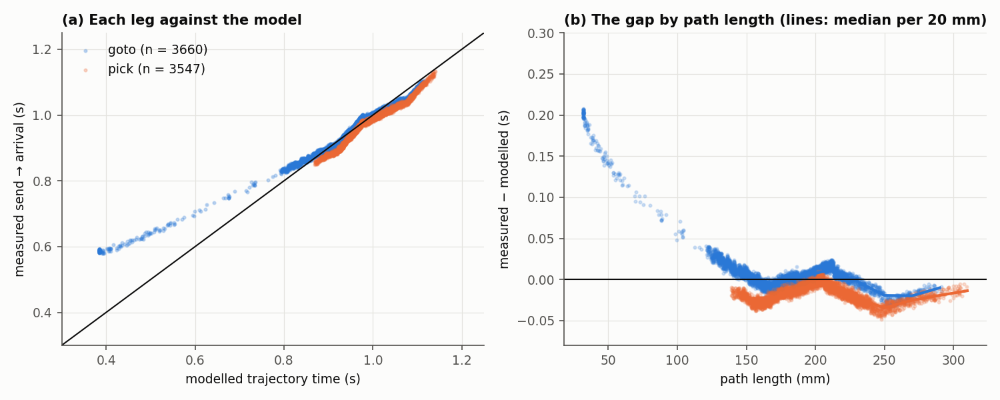
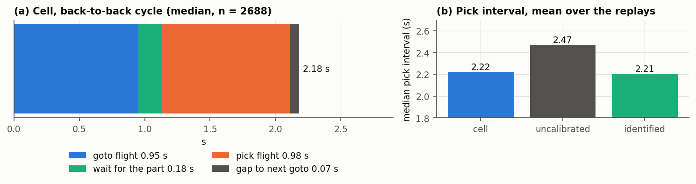
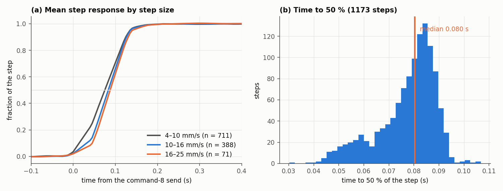
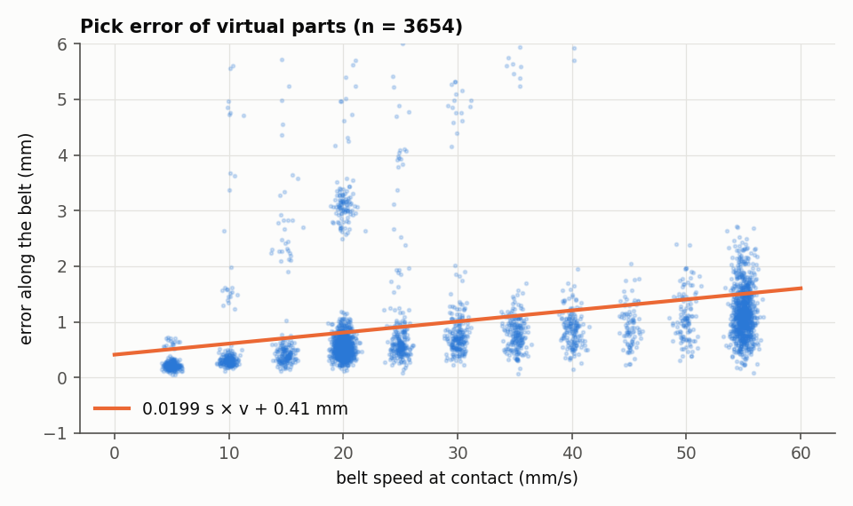
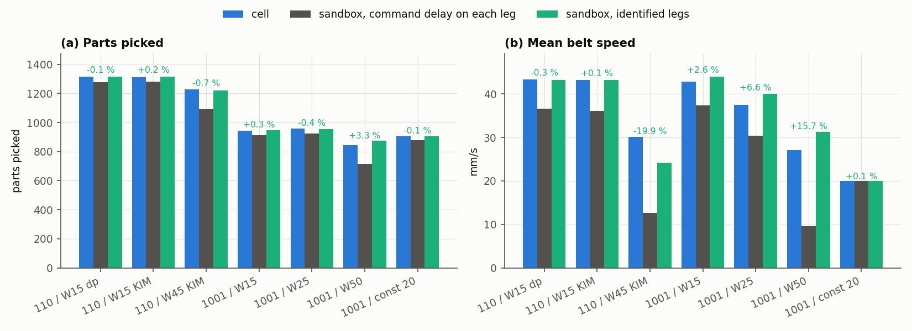
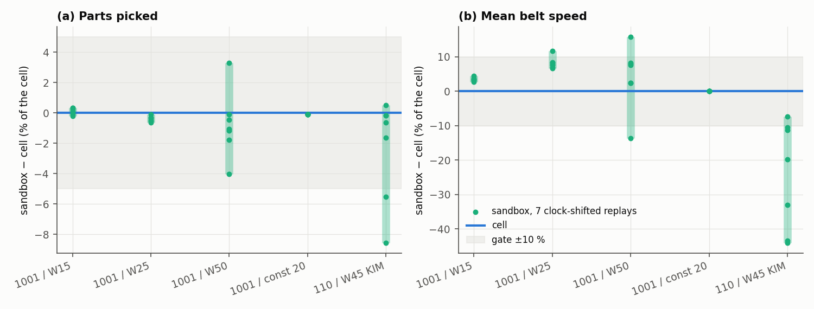
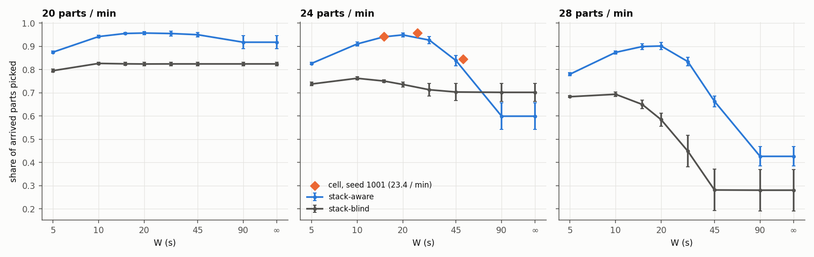

# Nhận dạng hệ thống của cell gắp — phương pháp và kết quả

> Bản tiếng Anh: [`plant-identification.md`](plant-identification.md).
> Dữ liệu: session console `log/20261010-163210_exp_PR_DP_1010_console` (10/10/2026).
> Công cụ: `python3 -m modules.tools.identify_plant`. Biểu đồ: `doc/figures/identification/`
> (`sandbox/identification_figures.py`). Các vấn đề còn mở nằm ở [`open-issues.md`](open-issues.md);
> quyết định đi kèm nằm ở [`decision-log.md`](decision-log.md).

## Tóm tắt

Scheduler và sandbox đều dựa trên một mô hình của cell: tay máy mất bao lâu cho một chặng, một chu
kỳ gắp dài bao nhiêu, băng tải bám lệnh tốc độ ra sao. Báo cáo này đo các đại lượng đó trên cell và
kiểm tra sandbox đang dùng chúng.

| Đại lượng | Giá trị đo | Dùng ở đâu |
|---|---|---|
| Chặng goto, từ lúc gửi lệnh đến khi tới đích, trừ `trajectory_time` | +0,005 s (trung vị, 3660 chặng) | `sim.goto_extra_s` |
| Chặng pick, như trên | −0,019 s (3547 chặng) | `sim.pick_extra_s` |
| Chặng ngắn dưới 120 mm | chậm hơn mô hình tới +0,2 s | open-issues C5 |
| Gửi lệnh → tay máy bắt đầu động | 0,107 s | soft start của mô hình |
| Gửi lệnh pick → điểm thấp nhất | 0,221 s (sd 0,004), z = −298,10 mm | độ dẫn đầu của cổng gắp, open-issues T3 |
| Chu kỳ gắp liên tục | 2,18 s = 0,95 + 0,18 + 0,98 + 0,07 | khoảng cách giữa hai lần gắp của sandbox |
| Băng tải, tốc độ ổn định / setpoint | 1,000 | — |
| Băng tải, đáp ứng bước | 10 / 50 / 90 % sau 0,023 / 0,080 / 0,126 s kể từ lúc gửi | open-issues L9 |
| Sai số gắp của vật ảo | 0,020 s × v + 0,41 mm | open-issues C10 |

Trước đây sandbox cộng độ trễ lệnh của mô hình (0,228 s) vào mọi chặng, khiến tay máy của nó chậm
hơn cell 0,28 s mỗi lần gắp. Khi thay độ trễ đó bằng các offset đã đo, sandbox tái hiện số vật gắp
của bảy run trên cell với sai lệch không quá 3,3 % và tốc độ băng tải của năm run trong vòng 10 % (§4.6).

## 1. Mục đích và phạm vi

Sandbox (`sandbox/`) chạy chính các planner và speed law của robot trên một tay máy và băng tải mô
phỏng. Kết luận của nó chỉ đúng với cell chừng nào plant mô phỏng còn khớp với cell. Hiệu chuẩn trước
đây chỉ là một hệ số kinh nghiệm (`sim.carry_scale = 0.8`) không rõ nguyên nhân.

Nhận dạng ở đây, từ log của tay máy và băng tải thật:

1. thời gian mỗi chặng của tay máy so với mô hình quỹ đạo trong `core/motion.py`;
2. chu kỳ gắp và thời gian đi vào đâu;
3. chuyển động hạ của cốc hút;
4. đáp ứng của servo băng tải với lệnh tốc độ;
5. sai số dọc băng tải của cổng gắp.

Không nhận dạng: mọi thứ liên quan đến camera hoặc vật thật (hệ số tỉ lệ băng tải C8, độ trễ chụp C9,
kiểm tra hút L6). Các vật trong session này là vật ảo (`simulate_feeder`): được sinh ra, đặt lên băng
tải thật và gắp bằng tay máy thật, nên không có đường camera.

## 2. Dữ liệu

Một session console, bốn run của scenario `simulate_feeder`, tất cả dùng planner `dp`, stack-aware,
1000 vật từ feeder Poisson 24 vật/phút, seed 1001:

| Run | Speed law | Vật gắp được | Thời lượng (s) |
|---|---|---|---|
| `run01` W15 | `predictive_rank`, W = 15 s | 943 | 2565 |
| `run02` W25 | `predictive_rank`, W = 25 s | 958 | 2580 |
| `run05` W50 | `predictive_rank`, W = 50 s | 846 | 2615 |
| `run06` const 20 | `constant`, 20 mm/s | 907 | 2572 |

`run03` và `run04` (4 và 0 lần gắp) là các lần khởi động bị hủy và bị loại: một run cần ít nhất 100
lần gắp (`--min-picked`). Giá trị W và speed law của từng run được kiểm tra theo `summary.json`
(`settings`) của nó, không theo tên thư mục.

Thư mục session chứa ba luồng dùng chung cho mọi run:

| Tệp | Nội dung | Tần suất |
|---|---|---|
| `pose.csv` | vị trí đầu tay máy từ luồng UDP của PLC, đóng dấu thời gian lúc PC nhận | ~12 ms |
| `commands.jsonl` | mọi lệnh gửi PLC: thời điểm gửi, thời điểm xong và gói tin | theo lệnh |
| `status.csv` | `speed_current` và vị trí băng tải, trạng thái tay máy | ~40 ms (20–25 Hz) |

và, theo từng run, `parts.csv` (mỗi vật một dòng: kết cục, sai số tại điểm chạm, tốc độ băng tải lúc
chạm). Các luồng được cắt thành từng run theo thời gian: một run kết thúc ở dòng `scenario … ended`
của `console.log` và bắt đầu sớm hơn `duration_s`. Mọi thời điểm là đồng hồ monotonic của PC.

## 3. Phương pháp

### 3.1 Chu kỳ gắp và mô hình plant

Mỗi lần gắp gồm hai lệnh quỹ đạo (lệnh 3) và một lệnh xoay (lệnh 7):

```
goto (từ thùng → phía trên vật)  →  chờ vật  →  pick (hạ, hút, nâng, mang về thùng)  →  goto kế tiếp
```

Một chặng lệnh 3 được nhận biết qua waypoint cuối: z = −287 mm kết thúc phía trên vật (goto),
z = −280 mm kết thúc trên thùng (pick). Scheduler dự đoán thời gian một chặng bằng
`trajectory_time(points)`: soft start cộng với profile từng đoạn của PLC có blend ở góc
(`core/motion.py`). Plant của sandbox thực thi một chặng trong

$$T_\text{leg} = T_\text{traj} + e,$$

trong đó phần cộng thêm $e$ là thứ báo cáo này nhận dạng. Trước đó, $e$ là độ trễ lệnh $d$ của mô hình
cho cả hai chặng:

$$d = d_\text{robot} + d_\text{eth} = 0{,}182 + 0{,}046 = 0{,}228\ \text{s}$$

với $d_\text{robot}$ = `robot_movement_delay_s` và $d_\text{eth}$ = `ethernet_delay_s`. $d$ là độ *dẫn đầu* mà
scheduler dành cho cổng gắp để cốc rơi đúng vào vật; đó không phải thời gian tay máy tiêu tốn khi bay.

### 3.2 Các chặng của tay máy

Với mỗi lệnh 3, dùng các mẫu pose từ lúc gửi đến lệnh 3 kế tiếp:

* $t_\text{send}$ — `t_mono_send` của lệnh;
* $t_\text{move}$ — mẫu đầu tiên cách pose xuất phát hơn 0,5 mm;
* $t_\text{arr}$ — mẫu đầu tiên, sau khi tay máy đã rời đi, nằm trong 1,0 mm quanh waypoint cuối;
* gap $= (t_\text{arr} - t_\text{send}) - T_\text{traj}$, với $T_\text{traj}$ tính từ chính các waypoint của
  gói tin và `robot.interpolator` trong config của session.

Gap được tóm tắt bằng trung vị và p5–p95 theo loại chặng, và như hàm của chiều dài đường đi (tổng
chiều dài các đoạn của gói tin).

### 3.3 Chu kỳ gắp

Với các bộ goto → pick → goto liên tiếp của một run: thời gian bay goto $= t_\text{arr} - t_\text{send}$ của
goto; thời gian chờ $=$ lúc gửi pick $-$ lúc goto tới; thời gian bay pick $=$ lúc pick tới $-$ lúc gửi pick;
khoảng nghỉ $=$ lúc gửi goto kế $-$ lúc pick tới. Chu kỳ có thời gian chờ dưới 0,35 s là *liên tục*
(back-to-back): tay máy không phải chờ vật, nên độ dài của nó chính là chu kỳ riêng của tay máy.

### 3.4 Chuyển động hạ

Với mỗi chặng pick: từ lúc gửi đến mẫu đầu tiên cách điểm thấp nhất không quá 0,5 mm, và giá trị z đó.
Độ cao gắp được lệnh là −300 mm.

### 3.5 Servo băng tải

Mỗi lệnh 8 đặt một tốc độ băng tải. Một bước được đo khi nó lớn hơn hoặc bằng 4 mm/s và không có lệnh 8
nào khác trong 1,2 s trước hoặc sau. Tốc độ trước là trung vị của `speed_current` trong 0,6 s trước lúc
gửi, tốc độ sau là trung vị từ 0,8 s sau đó. Các thời điểm phản hồi cắt mức 10, 50 và 90 % của bước được
tìm bằng nội suy tuyến tính giữa các mẫu, tính từ lúc gửi. Riêng biệt, trong mỗi khoảng ít nhất 3 s giữa
hai lệnh, trung vị của `speed_current` đã ổn định (từ 1,5 s sau lệnh) được so với setpoint.

### 3.6 Sai số gắp

`error_u_mm` của mọi vật đã gắp (vị trí theo dõi của vật so với cốc lúc chạm, dọc băng tải) được hồi quy
theo tốc độ băng tải lúc chạm: $\text{error}_u = a\,v + b$. Hệ số góc $a$ là một độ lệch thời gian.

### 3.7 Kiểm chứng bằng replay

Plant đã nhận dạng được kiểm tra toàn bộ bằng cách chạy lại các run của cell trong sandbox
(`experiments/phase0_replay.yaml`, `phase0_replay_1001.yaml`). Một replay đưa vào sandbox đúng chuỗi vật
đến của run (`arrivals.csv`) với đúng cấu hình mà run đã ghi, rồi so sánh:

| Kiểm tra | Ngưỡng |
|---|---|
| số vật gắp | lệch ≤ 5 % |
| tốc độ băng tải trung bình | lệch ≤ 10 % |
| vật có cùng kết cục, ghép theo thứ tự đến | ≥ 85 % |

Hai plant được so sánh trên cùng đầu vào: *chưa hiệu chuẩn* ($e = d$ cho cả hai chặng) và *đã nhận dạng*
($e$ = các trung vị đã đo, `carry_scale` = 1). Bộ seed 110 (ba run ngày 07–08/10) không dùng để nhận dạng,
nên nó kiểm tra plant trên các run chưa thấy; bốn run của session này là dữ liệu dùng để nhận dạng các
chặng, nên chúng kiểm tra việc nhận dạng từ đầu đến cuối, không kiểm tra khả năng tổng quát hóa.

## 4. Kết quả

### 4.1 Các chặng của tay máy



*Hình 1. (a) Thời gian đo từ lúc gửi đến lúc tới của từng chặng so với mô hình. (b) Gap theo chiều dài đường đi.*

| Chặng | n | gap p5 (s) | gap trung vị (s) | gap p95 (s) |
|---|---|---|---|---|
| goto | 3660 | −0,015 | **+0,005** | +0,034 |
| pick | 3547 | −0,034 | **−0,019** | −0,001 |

| Chiều dài đường đi (mm) | goto n | gap goto trung vị (s) | pick n | gap pick trung vị (s) |
|---|---|---|---|---|
| < 120 | 153 | +0,159 | 0 | – |
| 120–160 | 975 | +0,012 | 428 | −0,024 |
| 160–200 | 1326 | −0,001 | 1237 | −0,016 |
| 200–240 | 962 | +0,009 | 1405 | −0,016 |
| 240–280 | 228 | −0,020 | 375 | −0,031 |
| 280–400 | 16 | −0,010 | 102 | −0,019 |

Trong khoảng 120–400 mm, mô hình khớp cell trong ±0,03 s (tỉ số 0,97–1,01): các giá trị của
`robot.interpolator` (v_max 1000, a_max 2250, d_max 1750 mm/s², soft start 0,08 s) tái hiện đúng thời gian
của nó. Dưới 120 mm, gap tăng dần khi đường đi ngắn lại, tới +0,2 s ở 30 mm; đó là 4 % số goto
(open-issues C5). Việc ghi lệnh mất 0,065 s (trung vị) và tay máy bắt đầu động sau lệnh 0,107 s, khoảng
này soft start 0,08 s của mô hình đã bao phủ.

### 4.2 Chu kỳ gắp



*Hình 2. (a) Chu kỳ liên tục của cell. (b) Khoảng cách giữa hai lần gắp (trung vị) của các run được replay: cell, sandbox chưa hiệu chuẩn, sandbox đã nhận dạng.*

| Thành phần của chu kỳ (s) | p5 | trung vị | p95 | n |
|---|---|---|---|---|
| bay goto | 0,845 | 0,945 | 1,047 | 3516 |
| chờ vật | 0,108 | 0,194 | 2,513 | 3516 |
| bay pick | 0,880 | 0,972 | 1,074 | 3543 |
| pick tới → goto kế | 0,013 | 0,072 | 0,396 | 3543 |
| gửi goto → gửi goto kế | 1,941 | 2,223 | 5,343 | 3650 |

| Run | số chu kỳ | liên tục | chu kỳ trung vị (s) | chu kỳ liên tục trung vị (s) |
|---|---|---|---|---|
| W15 | 942 | 675 | 2,224 | 2,180 |
| W25 | 957 | 702 | 2,240 | 2,196 |
| W50 | 845 | 645 | 2,258 | 2,215 |
| const 20 | 906 | 666 | 2,182 | 2,141 |

Chu kỳ của tay máy trên cell là 2,18 s: 0,95 s goto, 0,18 s chờ ở cổng, 0,98 s pick, 0,07 s sang goto
kế. Sandbox chưa hiệu chuẩn gắp mỗi 2,43–2,49 s trên cùng đầu vào (cell 2,18–2,28 s), chậm 0,28 s; với
các chặng đã nhận dạng nó gắp mỗi 2,19–2,21 s. Plant chưa hiệu chuẩn đã cộng $2 \times 0{,}228 = 0{,}456$ s
vào hai chặng. Chỉ 0,28 s trong đó hiện ra ở khoảng cách giữa hai lần gắp; phần còn lại nhiều khả năng bị
thời gian chờ vật hấp thụ, phần này chưa được truy riêng.

### 4.3 Chuyển động hạ

| Đại lượng | p5 | trung vị | p95 | n |
|---|---|---|---|---|
| gửi pick → điểm thấp nhất (s) | 0,214 | 0,221 | 0,227 | 3654 |
| z thấp nhất (mm) | −298,157 | −298,101 | −298,062 | 3654 |

Cốc luôn xuống cùng một độ sâu, 0,221 s sau lúc gửi (sd 0,004 s), thiếu 1,9 mm so với −300 mm được lệnh
(open-issues T3). Giá trị 0,221 s khớp với độ dẫn đầu của cổng, $d = 0{,}228$ s.

### 4.4 Servo băng tải



*Hình 3. (a) Đáp ứng bước trung bình, chuẩn hóa, theo cỡ bước. (b) Thời gian đến 50 % của bước.*

| Điểm của bước (từ lúc gửi) | p5 (s) | trung vị (s) | p95 (s) | n |
|---|---|---|---|---|
| 10 % | −0,011 | 0,023 | 0,051 | 1159 |
| 50 % | 0,053 | 0,080 | 0,091 | 1173 |
| 90 % | 0,113 | 0,126 | 0,140 | 1173 |

| \|bước\| (mm/s) | n | 10 % (s) | 50 % (s) | 90 % (s) |
|---|---|---|---|---|
| 4–10 | 711 | 0,016 | 0,076 | 0,125 |
| 10–16 | 388 | 0,044 | 0,084 | 0,127 |
| 16–22 | 71 | 0,048 | 0,089 | 0,131 |

| Dải setpoint (mm/s) | đoạn ổn định | trung vị (tốc độ − setpoint) | trung vị (tốc độ / setpoint) |
|---|---|---|---|
| 0–15 | 203 | −0,009 | 0,9981 |
| 15–25 | 141 | +0,016 | 1,0008 |
| 25–40 | 189 | +0,007 | 1,0003 |
| 40–60 | 689 | +0,004 | 1,0001 |

Phản hồi ổn định đúng ở setpoint. Một bước mất khoảng 0,04 s để bắt đầu và 0,1 s để kết thúc, bất kể cỡ
bước (4–22 mm/s): quá trình chuyển là một thời gian cố định, không phải giới hạn gia tốc 500 mm/s²
(giới hạn đó chỉ mất 0,04 s cho 20 mm/s). Trạng thái được lấy mẫu mỗi ~40 ms nên hình dạng bên trong
một bước không phân giải được. Phản hồi này là của *cái gì* (encoder, không phải bề mặt băng tải) thì
báo cáo này không kiểm tra (open-issues C8).

### 4.5 Sai số gắp



*Hình 4. Sai số dọc băng tải của 3654 vật ảo đã gắp theo tốc độ băng tải lúc chạm.*

| Tốc độ băng tải (mm/s) | số lần gắp | sai số trung vị (mm) | sd (mm) |
|---|---|---|---|
| 0–15 | 518 | +0,28 | 0,83 |
| 15–25 | 1294 | +0,55 | 0,95 |
| 25–40 | 609 | +0,74 | 1,08 |
| 40–60 | 1233 | +1,09 | 1,60 |

Đường hồi quy là sai số = 0,0199 s × v + 0,41 mm: cốc rơi trễ khoảng 20 ms và lệch 0,4 mm, nên thời
điểm của cổng gắp và tay máy giải thích được tối đa 1,6 mm ở 60 mm/s. Các sai số lớn hơn trong hình
(tới 11 mm) là từng vật riêng lẻ; nguyên nhân của chúng chưa được phân tích ở đây. Với vật thật, các lần
gắp trễ ngày 02/10/2026 là 7–15 mm, nên chúng nằm ở các thành phần camera và hệ số tỉ lệ băng tải
(open-issues C8–C10), không nằm ở cổng gắp.

### 4.6 Kiểm chứng bằng replay



*Hình 5. Cell so với sandbox: số vật gắp và tốc độ băng tải trung bình; nhãn xanh lá là độ lệch của plant đã nhận dạng so với cell.*

| Replay (seed feeder / run) | Gắp: cell | chưa HC | đã nhận dạng | Băng tải (mm/s): cell | chưa HC | đã nhận dạng | Vật khác kết cục | Ngưỡng |
|---|---|---|---|---|---|---|---|---|
| 110 / W15 dp | 1316 | 1277 | 1315 | 43,3 | 36,6 | 43,2 | 2,4 % | đạt |
| 110 / W15 KIM | 1312 | 1283 | 1315 | 43,2 | 36,1 | 43,2 | 2,4 % | đạt |
| 110 / W45 KIM | 1227 | 1090 | 1219 | 30,2 | 12,7 | 24,2 | 8,6 % | trượt băng tải |
| 1001 / W15 | 943 | 912 | 946 | 42,9 | 37,4 | 44,0 | 4,5 % | đạt |
| 1001 / W25 | 958 | 923 | 954 | 37,5 | 30,4 | 40,0 | 2,8 % | đạt |
| 1001 / W50 | 846 | 715 | 874 | 27,1 | 9,6 | 31,3 | 9,6 % | trượt băng tải |
| 1001 / hằng 20 | 907 | 877 | 906 | 20,0 | 20,0 | 20,0 | 0,5 % | đạt |

(HC = hiệu chuẩn.) Với plant đã nhận dạng, số vật gắp khớp trong 3,3 % ở cả bảy replay và tốc độ băng
tải khớp trong 10 % ở năm replay. Plant chưa hiệu chuẩn trượt ngưỡng băng tải ở sáu replay và ngưỡng số
vật gắp ở hai replay (W45 và W50). Hai lần trượt băng tải đều ở W ≥ 45 s, với dấu ngược nhau (sandbox
thấp hơn cell 20 % ở W45, cao hơn 16 % ở W50), trong khi số vật gắp ở đó vẫn khớp; các replay ở §4.7 cho thấy
trường hợp thứ nhất (W50) là độ phân tán của chính vòng kín, còn trường hợp thứ hai (W45) là một độ lệch thật. Ở các
replay seed 1001, việc hủy ở cổng gắp khi mục tiêu bị đè (`sim.gate_cover_abort`) của sandbox được bật,
như trên cell.

### 4.7 Ngưỡng nhiễu và độ khớp theo thời gian

Một replay là tất định, nên một con số của sandbox không phân biệt được sai lệch mô hình với độ phân tán
của một vòng kín hỗn loạn. `experiments/phase0_noise.yaml` chạy lại mỗi run của cell bảy lần với plant
không đổi và đồng hồ mô phỏng lệch vài mili giây (`sim.dt_s` 4–6 ms, `sim.replan_period_s` 45–55 ms), cỡ
jitter của chính vòng poll của robot và đường truyền.



*Hình 7. Sandbox trừ cell, tính theo phần trăm của cell, bảy replay lệch đồng hồ cho mỗi run của cell; dải xám là ngưỡng.*

| Run của cell | Gắp: cell | sandbox trung bình ± sd [min–max] | Băng tải (mm/s): cell | sandbox trung bình ± sd [min–max] |
|---|---|---|---|---|
| 1001 / W15 | 943 | 943,9 ± 2,0 [941–946] | 42,88 | 44,36 ± 0,24 [44,01–44,75] |
| 1001 / W25 | 958 | 954,1 ± 1,7 [952–957] | 37,52 | 40,58 ± 0,62 [40,00–41,88] |
| 1001 / W50 | 846 | 839,6 ± 18,6 [812–874] | 27,05 | 28,24 ± 2,47 [23,35–31,31] |
| 1001 / hằng 20 | 907 | 906,0 ± 0 | 19,99 | 20,00 ± 0 |
| 110 / W45 KIM | 1227 | 1198,6 ± 41,8 [1122–1233] | 30,15 | 22,86 ± 4,76 [16,89–27,94] |

| Run của cell | RMSE tốc độ băng tải so với các bucket 10 s của cell (mm/s) | RMSE thông lượng 60 s (vật/phút) | Khoảng cách phân bố khoảng gắp (KS) |
|---|---|---|---|
| 1001 / W15 | 6,1 | 1,16 | 0,060 |
| 1001 / W25 | 9,8 | 1,67 | 0,062 |
| 1001 / W50 | 8,1 | 2,91 | 0,087 |
| 1001 / hằng 20 | 0,15 | 0,38 | 0,073 |
| 110 / W45 KIM | 17,0 | 3,61 | 0,160 |

Điều rút ra:

* **W50 (seed 1001) không phải là sai lệch mô hình.** Tốc độ băng tải của cell (27,1 mm/s) và số vật gắp
  (846) nằm trong khoảng phân tán của bảy replay; độ phân tán của chính sandbox ở W = 50 s là ±9 % ở
  tốc độ băng tải và ±2 % ở số vật gắp. Việc "trượt" ngưỡng băng tải ở §4.6 là độ phân tán của vòng kín.
  Ngưỡng 10 % áp lên một con số tất định chặt hơn độ lặp lại của chính vòng điều khiển ở cửa sổ dài.
* **W15 và W25 (seed 1001) có một lệch nhỏ.** Tốc độ băng tải của sandbox cao hơn cell ở mọi bản sao, 3,4 %
  và 8,1 %, với độ phân tán 0,5–1,5 %; số vật gắp khớp trong 0,5 %. Lệch này dưới ngưỡng và chưa rõ nguyên nhân.
* **W45 (seed 110, KIM) thấp hơn cell ở cả bảy bản sao** (băng tải −24 % trung bình, từ −7 % đến −44 %),
  trong khi số vật gắp vẫn nằm trong khoảng phân tán. Run đó từ 07/10/2026, trước khi cổng gắp có việc hủy khi
  mục tiêu bị đè và một số thay đổi khác, nên code của cell khác với code sandbox đang theo. Đây là trường
  hợp duy nhất mà độ lệch nằm ngoài nhiễu, và nguyên nhân chưa được truy.
* **Bản thân tay máy khớp.** Ở hằng 20 mm/s replay không phân tán (906 vật gắp ở cả bảy lần), đường thông
  lượng lệch 0,38 vật/phút (1,7 % của 22 vật/phút) và 99,5 % số vật có cùng kết cục. Phân bố khoảng gắp khác
  nhau KS = 0,06–0,09 (0,16 ở W45).
* **Theo thời gian, băng tải không bám sát.** RMSE băng tải là 6–10 mm/s so với các bucket 10 s ở W15–W50
  (14–29 % giá trị trung bình), đúng như dự kiến khi hai lần chạy của một vòng kín hỗn loạn đi theo đường
  khác nhau nhưng cùng về một giá trị trung bình: sandbox là mô hình của số liệu tổng hợp, không phải của từng khoảnh khắc.

Các tinh chỉnh plant mà dữ liệu gợi ý đã không được thực hiện. Có 4 % số chặng goto chậm hơn mô hình 0,16 s;
tính trên mọi lần gắp đó là 0,007 s trong chu kỳ 2,2 s, tức 0,3 %, thấp hơn nhiều so với độ phân tán trong
bảng. Các mục `cell` của `sandbox/models/delta.yaml` giống hệt `config.yaml` của session, và các thiết lập
`scheduling`, `speed`, feeder của run lấy từ `summary.json` của chính nó, nên không còn thiết lập nào cần căn
lại. Độ trễ phát hiện của feeder (11 ms) không được mô hình hóa: 0,5 mm ở 45 mm/s.

### 4.8 Ý nghĩa với bản đồ W



*Hình 6. Tỉ lệ vật đến được gắp theo cửa sổ W của `predictive_rank` (sandbox, KIM, 5 seed × 1 h, trung bình ± sd) và ba điểm của cell.*

Bản đồ của `experiments/w_map.yaml` được chạy lại với plant đã nhận dạng và khác bản trước không quá
0,025 ở các ô được trích trong open-issues S2: ở 24 vật/phút, W tốt nhất là 20 s (0,949), W = 45 s cho
0,839 và W ≥ 90 s cho 0,599. Ba run của cell trong session này (0,943, 0,958 và 0,846 ở W = 15, 25,
50 s; 23,4 vật/phút đến) nằm trên đường cong của sandbox, trong hoặc sát biên độ dao động của nó. Ba
run của một seed ủng hộ hình dạng của đường cong, không phải vị trí đỉnh của nó.

## 5. Giới hạn của việc nhận dạng này

* **Vật ảo.** Không có camera, không có các thành phần hệ số tỉ lệ băng tải hay độ trễ; việc hút không
  được dùng để đánh giá lần gắp (open-issues L6, L17).
* **Dấu thời gian.** `pose.csv` đóng dấu lúc PC nhận, nên độ trễ không đổi phía PLC nằm lẫn trong thời
  gian đo (open-issues L15). Trạng thái băng tải được lấy mẫu mỗi ~40 ms.
* **Một session, một ngày.** Việc nhận dạng và phép kiểm tra từ đầu đến cuối dùng cùng bốn run; chỉ các
  replay seed 110 là dữ liệu chưa thấy, và chúng có trước session này.
* **Trung vị.** Plant dùng độ cộng thêm trung vị cho mỗi chặng; độ phân tán (p5–p95 khoảng ±0,03 s) và
  sự phụ thuộc vào chiều dài đường đi (Hình 1b) không được mô hình hóa.
* **Độ nhạy của vòng kín.** Planner và speed law mang tính hỗn loạn: một vật có thể đổi kết cục chỉ vì
  chênh 10 ms. Hãy đánh giá theo số liệu tổng hợp; mức khớp theo từng vật (90–99 %) là phát biểu yếu hơn
  các tổng. Mỗi thiết lập chỉ có một run của cell nên độ phân tán giữa các lần chạy của chính cell chưa biết; §4.7 đo
  độ phân tán của sandbox.
* **Các chặng goto dưới 120 mm.** Cell mất lâu hơn mô hình quỹ đạo tới 0,2 s; plant của sandbox dùng
  cùng mô hình đó cộng độ lệch trung vị, nên nó chạy các chặng này nhanh như planner kỳ vọng, không
  chậm như cell.

## 6. Tái lập

```bash
# phép đo: bảng, legs.csv, biểu đồ bốn khung (khoảng 5 s)
python3 -m modules.tools.identify_plant log/20261010-163210_exp_PR_DP_1010_console

# kiểm chứng (khoảng 10 phút) và bản đồ W (khoảng 50 phút trên 15 lõi)
bash sandbox/run_experiments.sh phase0
bash sandbox/run_experiments.sh w_map

# ngưỡng nhiễu của §4.7 (khoảng 25 phút)
bash sandbox/run_experiments.sh phase0_noise

# các biểu đồ của báo cáo này
.venv/bin/python -m sandbox.identification_figures log/20261010-163210_exp_PR_DP_1010_console \
    --replay sandbox/results/phase0_replay-<time> sandbox/results/phase0_replay_1001-<time> \
    --w-map sandbox/results/w_map-<time> --noise sandbox/results/phase0_noise-<time> \
    --out doc/figures/identification
```

Các hằng số của sandbox nằm trong `sandbox/config.yaml` (`sim.goto_extra_s`, `sim.pick_extra_s`).
Plant cũ là `null` cho cả hai. Log của cell được lưu trong `log/archived.zip`; sandbox giải nén từng run
từ đó khi cần.

## 7. Kết quả được ghi ở đâu

| Mục | Nơi ghi |
|---|---|
| Mô hình quỹ đạo so với cell, chặng ngắn | open-issues C5 |
| Độ sâu và thời gian hạ | open-issues T3 |
| Phần của cổng gắp và tay máy trong sai số gắp | open-issues C10 |
| Đáp ứng bước của băng tải | open-issues L9 |
| Sandbox đã kiểm chứng, ngưỡng nhiễu, tốc độ băng tải trung bình ở W dài | open-issues S3 |
| Các điểm của cell trên bản đồ W | open-issues S2 |
| Vì sao `carry_scale` bị thay | decision-log, 10/10/2026 |
